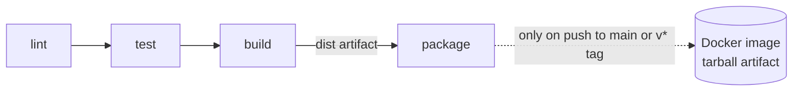

# SkillsForge CI Pipeline: lint → test → build → package

[](https://github.com/cloudpixie925/skillsforge-ci-pipeline/actions/workflows/ci.yml)

A small Node.js HTTP service (Express) with a GitHub Actions pipeline that lints, tests, builds and packages it into a Docker image. Built for the SkillsForge DevOps / Cloud Engineering second-stage task.

| Endpoint | Example | Response |
|---|---|---|
| `GET /healthz` | `curl localhost:3000/healthz` | `{"status":"ok","version":"dev"}` |
| `GET /api/greet?name=Ada` | `curl "localhost:3000/api/greet?name=Ada"` | `{"message":"Hello, Ada!"}` |
| `POST /api/sum` | `curl -X POST -H "content-type: application/json" -d '{"numbers":[1,2,3]}' localhost:3000/api/sum` | `{"sum":6}` (400 for bad input) |

## Project layout

```
src/lib.js            pure logic (greet, sum)
src/app.js            Express app factory (no network side effects, easy to test)
src/server.js         entry point: starts the server, handles SIGTERM
test/*.test.js        11 unit tests (Node's built-in test runner, no extra dependency)
eslint.config.js      ESLint flat config
scripts/build.mjs     esbuild bundle -> dist/server.cjs (+ source map, build-info.json)
Dockerfile            packages dist/ into a non-root node:24-alpine image
.github/workflows/ci.yml   the pipeline
package-lock.json     lockfile; every dependency is pinned to an exact version
```

## Run it locally

Requirements: Node.js 22 or newer (24 recommended, see `.nvmrc`), npm, and Docker for the image.

```bash
npm ci              # clean install exactly what package-lock.json says
npm run lint        # ESLint
npm test            # 11 unit tests
npm run build       # bundles the app into dist/server.cjs
npm start           # runs from source on http://localhost:3000
npm run start:dist  # runs the built bundle instead
```

Docker (build first, because the image only packages `dist/`):

```bash
npm run build
docker build -t skillsforge-ci-demo:local .
docker run --rm -p 3000:3000 skillsforge-ci-demo:local
curl localhost:3000/healthz
```

## The pipeline



| Requirement | Where in `.github/workflows/ci.yml` |
|---|---|
| Four jobs: lint, test, build, package | lines 25, 55, 86, 125 |
| Later stages stop when an earlier one fails | `needs:` on lines 57, 88, 127 |
| Dependency cache, refreshed when the lockfile changes | `actions/cache` keyed on `hashFiles('package-lock.json')` (lines 45, 76, 107) |
| Runs on PRs to main, pushes to main, `v*` tags | lines 3–8 |
| package never runs on pull requests | `if:` on line 129 |
| Build output passed as an artifact, not rebuilt | upload on line 118, download on line 139 |
| Older run cancelled when a newer commit arrives | `concurrency` on lines 16–18 |
| Least privilege, no secrets in the repo | `permissions: contents: read` on lines 12–13, `persist-credentials: false` on every checkout |

Third-party actions are pinned to full commit SHAs (with the version in a comment), so a moved or hijacked tag cannot change what runs.

## Evidence

| What | Link |
|---|---|
| Green run, all four jobs passing (cold cache) | [run, attempt 1](https://github.com/cloudpixie925/skillsforge-ci-pipeline/actions/runs/41246905650/attempts/1) |
| Same unchanged commit re-run, cache hit (warm cache) | [run, attempt 2](https://github.com/cloudpixie925/skillsforge-ci-pipeline/actions/runs/41246905650/attempts/2) |
| PR with a lint error: lint fails, test, build, package skipped | [pull request](https://github.com/cloudpixie925/skillsforge-ci-pipeline/pull/1) |
| PR with a failing test: test fails, build, package skipped | [pull request](https://github.com/cloudpixie925/skillsforge-ci-pipeline/pull/2) |
| PR with a broken build: build fails, package skipped | [pull request](https://github.com/cloudpixie925/skillsforge-ci-pipeline/pull/3) |
| Tag `v1.0.0`: full pipeline including package on a tag | [run](https://github.com/cloudpixie925/skillsforge-ci-pipeline/actions/runs/41247141135) |
| All runs | [Actions tab](https://github.com/cloudpixie925/skillsforge-ci-pipeline/actions) |

The three pull requests are deliberately left open and must not be merged.

## Pipeline design

### 1. Stage order

The jobs run **lint → test → build → package**, ordered from the cheapest, fastest check to the most expensive one. Linting takes seconds and needs no code to execute, so it catches the most common mistakes first. Tests run the code, so they come next. The build only matters for code that is known to be correct, and packaging (a Docker build plus smoke test) is the slowest step and only useful for code that will actually be released, so it is last and only runs on pushes.

I ran lint and test **in sequence**, because the task asks for later stages to stop when an earlier one fails. The tradeoff:

| | Sequential (chosen) | Lint and test in parallel |
|---|---|---|
| Wall-clock time | Longer: the times add up, and each job pays its own start-up, checkout and `npm ci` (about 15–25 s each) | Shorter: roughly the time of the slower job |
| Compute minutes | Lower when lint fails, because test never starts | Both jobs always run, so a lint failure still pays for tests |
| Feedback | One failure at a time | Lint and test failures are reported together |

Public repositories get free minutes, so here the cost difference is small, but on a private repository (billed per job, rounded up to the minute) the sequential order saves money on every failing push. If speed mattered more than cost, I would run lint and test in parallel and make build depend on both (`needs: [lint, test]`).

### 2. Caching

**What is cached:** `~/.npm`, npm's download cache of package tarballs, not `node_modules`. `npm ci` always deletes `node_modules` and reinstalls exactly what the lockfile says, so the cache only saves the network download. It also avoids restoring a `node_modules` built for a different Node version or with the wrong platform binary (esbuild ships a native binary).

**Cache key** (lines 45, 76, 107):

```
npm-${{ runner.os }}-node${{ env.NODE_VERSION }}-${{ hashFiles('package-lock.json') }}
e.g.  npm-Linux-node24-3f9c…e1a2
```

with the fallback `restore-keys: npm-Linux-node24-`.

**When the lockfile changes,** its hash changes, so the exact key misses. `restore-keys` then restores the most recent older cache with the same prefix (a partial hit), so most tarballs still come from disk and `npm ci` downloads only the new or changed packages. Because the exact key missed, the post-job step saves a new cache under the new key. Caches are immutable, so a new key is the only way the cache gets refreshed. Unused caches are evicted after 7 days.

**With a fixed key such as `deps`,** the first run would save the cache and it would never be updated again, because GitHub never overwrites an existing key. After a dependency change, every run would still report a "cache hit" while silently downloading the new packages from the registry, so the cache becomes stale and misleading. If `node_modules` were cached under a fixed key it would be worse: CI could test against old dependency versions, or restore files built for another OS or Node version, and pass or fail for reasons that have nothing to do with the code.

### 3. Fail-fast

A job with `needs:` runs only if every job it needs succeeded (an implicit `if: success()`), and a skipped job counts as not succeeded, so one failure skips everything after it.

| Pull request | Ran | Skipped | Workflow lines responsible |
|---|---|---|---|
| [Lint error](https://github.com/cloudpixie925/skillsforge-ci-pipeline/pull/1) (unused constant in `src/lib.js`) | lint ✗ | test, build, package | `run: npm run lint` (53) exits non-zero; test has `needs: lint` (57); build has `needs: test` (88); package has `needs: build` (127) |
| [Failing test](https://github.com/cloudpixie925/skillsforge-ci-pipeline/pull/2) (default name changed to "Everyone") | lint ✓, test ✗ | build, package | `run: npm test` (84) fails; `needs: test` (88) skips build; `needs: build` (127) skips package |
| [Broken build](https://github.com/cloudpixie925/skillsforge-ci-pipeline/pull/3) (imports a missing `./banner.js`) | lint ✓, test ✓, build ✗ | package | `run: npm run build` (115) fails because esbuild cannot resolve the import, so the upload step (118) never runs; `needs: build` (127) skips package |

The broken build passes lint and test on purpose: ESLint does not resolve imports and the tests import `app.js`, not `server.js`, so only the bundler notices. On pull requests the package job is also excluded by the `if:` on line 129, so it would show as skipped even if build had passed.

### 4. Speed

Timings come from the GitHub API for attempt 1 (cold) and attempt 2 (warm) of the same run on the same commit:

| | Cold run | Warm run |
|---|---|---|
| Wall-clock time (whole run) | 64 s | 66 s |
| Sum of all job times (billable) | 52 s | 51 s |
| `npm ci` step per job | lint 3s / test 2s / build 1s | lint 1s / test 1s / build 2s |

**What accounts for the difference.** In the cold run no cache existed yet, so the lint job's `npm ci` downloaded every package from the npm registry. At the end of the lint job the cache was saved, which means test and build in the same run already restored it. In the warm run all three jobs restored the cache in about a second, and `npm ci` only unpacked tarballs from disk. Most of the remaining time is fixed per-job overhead that caching cannot remove: getting a runner, checkout, setting up Node, and the Docker build and smoke test in package. Runner start-up also varies by a few seconds between runs, so on a project this small the clearest signal is the `npm ci` step in the lint job; the saving grows with the number of dependencies.

**Cancelling older runs.** Lines 16–18 put every run in a group named after the workflow and the branch (`github.ref`) with `cancel-in-progress: true`. If someone pushes three commits in two minutes, commit 2 cancels the run for commit 1 and commit 3 cancels the run for commit 2, so only the latest commit is fully tested. That uses about a third of the minutes, frees runners for other work, gives faster feedback on the commit that matters, and stops an older run from finishing last and reporting a stale result (or an older package job producing an image after a newer one). Different branches and pull requests have different refs, so they never cancel each other.

### 5. Safety

The registry password would be stored as an **encrypted GitHub Actions secret**, ideally an environment secret on an environment such as `registry`, restricted to `main` and `v*` tags (optionally with a required reviewer). Only the package job would declare that environment and read it, and it would go straight into a login action, never into an `echo`:

```yaml
  package:
    environment: registry
    steps:
      - uses: docker/login-action@<pinned-sha>
        with:
          registry: registry.example.com
          username: ${{ vars.REGISTRY_USERNAME }}
          password: ${{ secrets.REGISTRY_PASSWORD }}
```

Better still is no long-lived password at all: for GitHub Container Registry, give only the package job `permissions: packages: write` and log in with the built-in `GITHUB_TOKEN`, which expires when the job ends. For AWS ECR or Google Artifact Registry, use OIDC (`permissions: id-token: write`) to exchange a short-lived token for temporary cloud credentials.

Pull requests from forks must not get it because their code is untrusted, and CI executes it: `npm ci` runs install scripts, the tests run arbitrary code, and the PR can even edit the workflow file. With the secret available, a malicious PR could print it in an encoded form that defeats log masking, send it to an outside server, or push a poisoned image under the project's name. GitHub therefore withholds secrets from `pull_request` runs triggered by forks and gives them a read-only token, and this workflow never runs package on pull requests at all (line 129). For the same reason I would never combine `pull_request_target` with a checkout of the PR's code.

### 6. Improve it

1. **Publish, scan and sign the image on tags.** Push to GHCR using `GITHUB_TOKEN` (with `packages: write` only on the package job), scan with Trivy and fail on HIGH or CRITICAL vulnerabilities, generate an SBOM and a build-provenance attestation, and pin the base image by digest. *Problem solved:* today the image is only built, smoke-tested and stored as a tarball, so nothing can deploy it, and nothing stops a vulnerable base image or a tampered artifact from being shipped.
2. **Protect `main` and keep dependencies fresh.** Add a branch ruleset that requires the lint, test and build checks plus one review before merging, and add Dependabot for `npm` and `github-actions` so the SHA-pinned actions and the lockfile get update PRs that go through this same pipeline. *Problem solved:* at the moment a red pull request can still be merged, and pinned versions slowly go out of date and miss security fixes.

## Assumptions

- **Language:** Node.js. CI and the Docker image use Node 24 (the current LTS line); the code also runs on Node 22.
- **"Stages"** are four separate jobs chained with `needs:`, so each one shows its own status (passed, failed or skipped) in the Actions UI.
- **Packaging** means building the Docker image from the `dist/` artifact, smoke-testing it and keeping it as a 7-day artifact. It is not pushed to a registry, because the task says not to put secrets in the repository; question 5 explains how pushing would work.
- **Lockfile:** `package-lock.json`, with exact versions in `package.json` as well. Dependency and action versions were chosen from releases at least two weeks old.
- **Test runner:** Node's built-in `node:test`, so tests add no dependencies; the 11 tests cover both the pure logic and the HTTP endpoints.
- **Cold vs warm:** "cold" is the first run of the repository (no cache existed); "warm" is a re-run of the same commit. The timings table was filled in from the GitHub API right after those runs.
- The three evidence pull requests are intentionally left open and unmerged.
